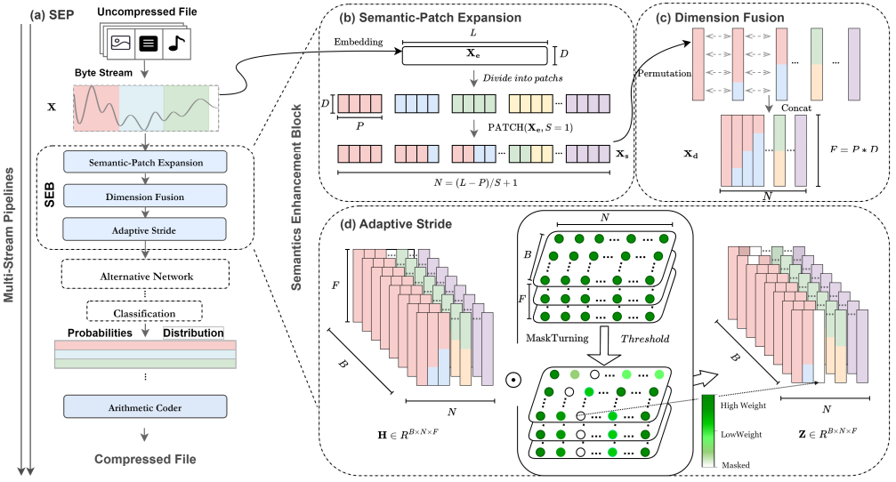
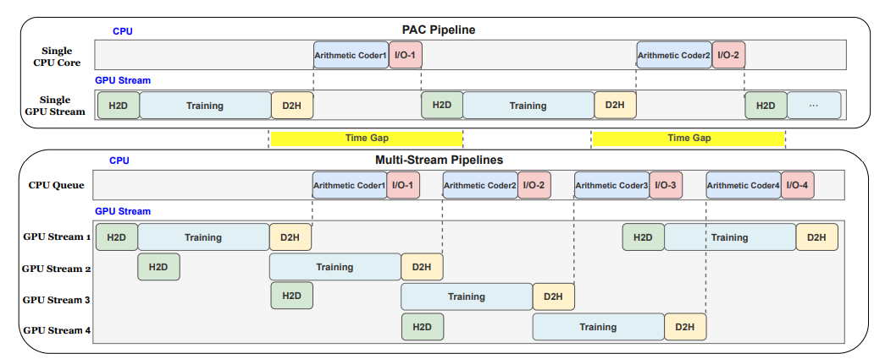
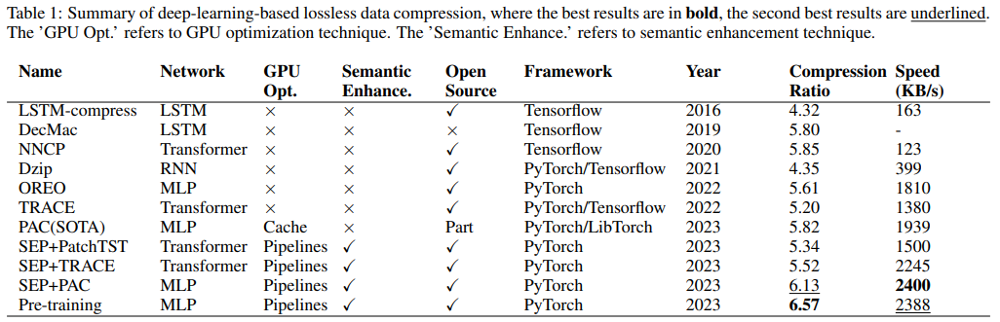
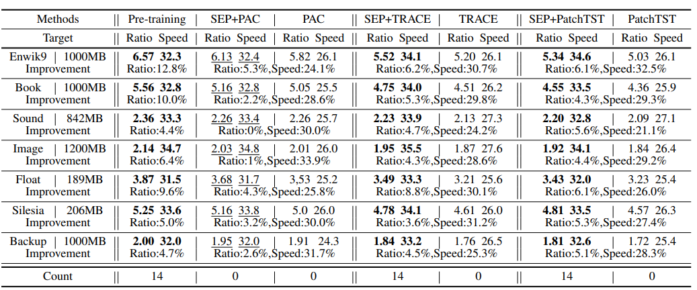

# SEP Framework

This is an official implementation for the paper: **SEP: A General Lossless Compression Framework with Semantics Enhancement and Multi-Stream Pipelines**.
SEP is a deep-learning-based lossless compression framework, designed to improve both the compression speed and compression ratio. SEP framework stands out by transforming existing single-byte symbols into sub-sequence level patches, enabling a more efficient capture of compressed sequence correlations. At the same time, SEP uses GPU memory optimization and pipelines.


# Key Designs
🌟 **Semantics enhancement block**: We propose a series of novel approaches to capture complex semantic information of adjacent byte sequences, which achieve higher compression ratios across diverse data types.

🌟 **Multi-stream pipelines**: We propose multi-stream pipeline mechanism for parallel compression. By hiding disk I/O and CPU-GPU data transfer, such as Host to Device(H2D) and Device to Host(D2H), we try to maximize the hardware utilization for reducing the compression time. 

🌟 **GPU Memory Optimization**: We propose an innovative approach to reuse GPU memory across streams, while GPU memory is isolated for PyTorch streams. This approach achieves an average decrease of 36\% GPU memory usage in multi-stream environments.

🌟 **State-of-the-art(SOTA) compression performance**: We conduct experiments to prove that our framework can increase the compression ratio of the networks by an average of 5\% and increase the compression speed by 30\%. Our pre-training models can further improve the  average compression ratio to 7.6\%.

## Overall Architecture

The SEP framework with the workflow detail of the Semantics Enhancement Block (SEB). All types of uncompressed files are firstly converted to byte streams and sent to the SEB. The SEB then extracts the features of the byte stream and turns it into fusion patch with adaptive stride. By feeding the enhanced matrix $\mathbf{Z}$ into alternative networks, the probability distribution of the next byte is predicted. Finally, the byte stream with probability distribution is compressed by the arithmetic coder. The entire compression process is accelerated by the Multi-Stream Pipelines method.

<p align="center">

</p>

<p align="center">

</p>


## Usage

Run the commands below from the repository root. Install NumPy and PyTorch in
your Python environment. For the GPU commands, use a CUDA-enabled PyTorch
build. Replace `input.bin` with the path to any file you want to compress.

`--input_dir` takes a **file path**. For compression, pass the original file.
For decompression, pass the `.compressed.combined` archive. `--output` sets
the destination path for either operation.

### SEP+TRACE

```sh
python "4SEP+TRACE/stream-trace3cls.py" --mode=compress --device=cuda --input_dir input.bin --output trace.compressed.combined
python "4SEP+TRACE/stream-trace3cls.py" --mode=decompress --device=cuda --input_dir trace.compressed.combined --output trace.restored.bin
```

### SEP+PAC

```sh
python "2SEP+PAC/pac-patch-stride-stream-1.py" --mode=compress --device=cuda --input_dir input.bin --output pac.compressed.combined
python "2SEP+PAC/pac-patch-stride-stream-1.py" --mode=decompress --device=cuda --input_dir pac.compressed.combined --output pac.restored.bin
```

### SEP+PatchTST

```sh
python "6SEP+PatchTST/tst-patch-stride-stream.py" --mode=compress --device=cuda --input_dir input.bin --output patchtst.compressed.combined
python "6SEP+PatchTST/tst-patch-stride-stream.py" --mode=decompress --device=cuda --input_dir patchtst.compressed.combined --output patchtst.restored.bin
```

For a CPU round trip, replace `--device=cuda` with `--device=cpu` in both
commands. Use the same model entry point and compute backend for compression
and decompression. The decoder replays online training, so use the same
PyTorch environment for both operations whenever possible.

### Version 1 archive format

All three codecs write a binary `.compressed.combined` archive. The archive
starts with the codec identifier (`SEPTRACE`, `SEPPAC`, or `SEPPATCHTST`)
and a one-byte format version (`0x01`). A 4-byte big-endian length precedes
the JSON header, which records the original byte count, the model settings,
the compute backend, the CPU thread count when applicable, and the original
file's SHA-256 hash.

The header is followed by the arithmetic-coded streams, including a tail
stream when needed. Each stream has an 8-byte big-endian length prefix.
The decoder reads the model settings from the header and verifies the
restored bytes against the stored SHA-256 hash before replacing the output
file. Legacy `.compressed.combined` files lack this versioned header and are
incompatible with these decoders.

## Model Comparision

We use Compression Speed and Compression Ratio as model evaluation metrics. Overall, SEP model achieves the best performance in the vast majority of cases.

<p align="center">

</p>

## Pre-training Models
Available at: https://drive.google.com/file/d/18ltzjRFGDQrpu9Kz2zz28xQ9Obcnazpu/view?usp=sharing


## Pytorch Memory Sharing
```
cd PytorchMemorySharing/sharing

cp CUDACachingAllocator.cpp /PyTorch/xxx

```


## Main Results

To improve both compression ratio and compression speed of deep-learning-based lossless compressors, the existing research focus on different networks. The recent deep-learning-based lossless compressors are mainly built based on PyTorch. In Table, we present the various characteristics of several deep-learning-based compressors. Compressors like tensorflow-compress and DecMac use Long Short-Term Memory(LSTM) to capture long-term dependencies within the input data stream.  Through the studies on different networks, the latest research suggests that the mechanisms of transformer and multi-layer perception (MLP) can achieve even more accurate estimation and also higher compression speed compared to other deep-learning-based lossless compressors. NNCP, TRACE, OREO and PAC are the typical compressors which use transformer or MLP. The most deep-learning-based lossless compressors train their networks with GPU to speed up the compression process. PAC reduces the traffic of CPU-GPU data transfer using software cache in GPU memory, which helps PAC compressing faster. The work on GPU memory optimization is mainly focused on offloading, recomputation and defragmentation, with no attention paid to multi-stream reusage.

We put all the original experiment logs and results in the "/XXXmodel/results" directory.

<p align="center">

</p>

## Appendix
View the Appendix: APPENDIX_sep.pdf


